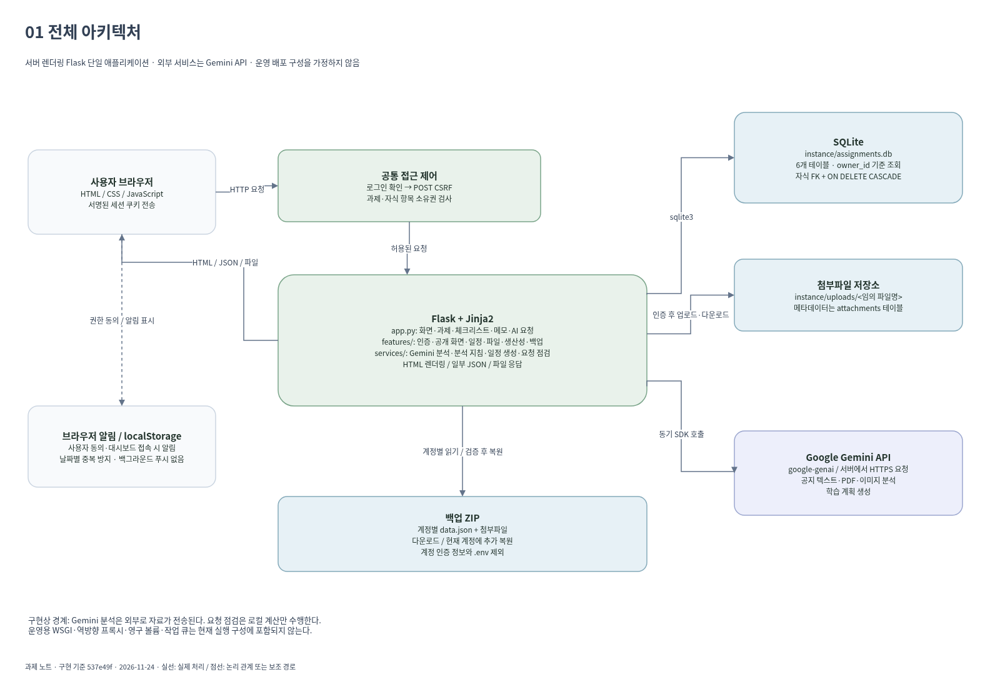

# 전체 아키텍처 설계서

- 프로젝트: 과제 노트 — 한국어 대학 과제 관리 웹서비스
- 정리일: 2026-11-24
- 구현 기준: `537e49f3b78bc155d71c68f34ef7145fae46e24f` (`main`과 일치 확인)
- 범위: 기능·UI 확장은 마무리하고 현재 구현을 문서화한다. 앞서 생성한 UI 대안 3개는 미선택 시안이므로 현재 설계에 포함하지 않는다.
- 설계 묶음: [제출용 안내](DESIGN_OVERVIEW.md) · [화면](SCREEN_DESIGN.md) · [데이터](DATA_MODEL.md) · [플로우차트](FLOWCHART.md)

## 1. 시스템 목적과 구성

학생이 과제 공지를 정리하고, 체크리스트·일정·마감·첨부파일을 계정별로 관리한다. AI 분석은 선택 기능이며, 키가 없어도 직접 과제 등록과 일반 관리가 가능하다.

현재 구조는 **Flask 단일 애플리케이션 + Jinja2 서버 렌더링 + SQLite + 로컬 첨부파일 저장소**이다. 일부 재점검 요청만 JSON 응답을 사용한다. 별도 SPA 프런트엔드, 독립 REST 서버, 작업 큐, Redis, 별도 DB 서버는 없다.



| 계층 | 실제 구성 | 역할 |
|---|---|---|
| 클라이언트 | 브라우저, HTML/CSS/JavaScript | 폼 전송, 내비게이션, 일부 fetch 요청, 브라우저 알림 |
| 프레젠테이션 | `templates/`, `static/css/`, `static/js/`, `static/images/`, `static/icons/` | 공개 소개와 개인 워크스페이스 렌더링 |
| 요청 제어 | `app.py`, `features/*.py` | 인증·CSRF·소유권·입력 검증, 화면/JSON/파일 응답 |
| 분석/업무 서비스 | `services/*.py` 및 기능 모듈의 업무 함수 | AI 호출, 요청 수량 점검, 일정·마감 계산, 백업 처리 |
| 데이터 접근 | 표준 라이브러리 `sqlite3`와 매개변수 SQL | 트랜잭션, 계정별 조회/갱신, 관계 무결성 |
| 영속 저장 | `instance/assignments.db`, `instance/uploads/` | 구조화 기록과 실제 첨부파일 |
| 외부 서비스 | Google Gemini API (`google-genai`) | 공지 텍스트/파일 분석, 학습 계획 생성 |

`features`와 `services`는 한 프로세스 안의 Python 모듈이다. 별도 마이크로서비스로 배포되어 있지 않다. 각 `register_*` 함수가 같은 Flask 앱에 경로를 등록하며, DB 함수와 소유권 함수는 인자로 전달된다.

## 2. 모듈별 책임

| 모듈 | 책임 |
|---|---|
| `app.py` | 앱 팩토리, 공통 설정·CSRF, DB 초기화, 공개/개인 대시보드 분기, 관리 목록/검색, 과제 CRUD, 체크리스트·메모, AI 분석·점검·저장, health |
| `features/auth.py` | 로컬 전용 회원가입, 로그인/로그아웃, 로그인 전 개인 경로 접근 제어 |
| `features/public.py` | 기능 사용 장면과 기존 고정 예시 경로 |
| `features/planning.py` | 오늘 작업/마감 조회, 일정 충돌, 수동 학습 계획과 자동 재계획 |
| `features/attachments.py` | 파일 검증·저장·인증 후 다운로드·삭제, 과제 삭제 시 파일 정리 |
| `features/productivity.py` | 오늘 직접 지정, 목록에서 상태 변경, 과목별 집계 |
| `features/backups.py` | 계정별 ZIP 백업, 검증·새 ID 재매핑·추가 복원 |
| `services/gemini_service.py` | 텍스트/멀티모달 Gemini 요청, JSON 응답 정규화, 오류 메시지 변환 |
| `services/analysis_guidelines.py` | 다양한 사용자 분석 요청을 위한 공통 지침 28개 |
| `services/requirement_checks.py` | 줄 수·글자 수·목록 수의 결정적 점검, 의미적 조건은 직접 검토로 분류 |
| `services/plan_service.py` | 일정 생성 API 호출, 날짜/개수/내용 길이 검증 |

## 3. 주요 요청 처리

### 일반 화면과 변경

1. 브라우저가 GET 또는 폼 POST를 보낸다.
2. `require_login`이 공개 경로와 개인 경로를 구분한다.
3. POST는 세션의 CSRF 토큰과 폼 토큰을 비교한다.
4. 개인 과제는 `owner_id IS session['user_id']`로 조회한다. 자식 항목은 그 과제에 연결되었는지도 확인한다.
5. 필드 검증을 통과하면 SQL/파일 작업을 수행한다.
6. HTML을 렌더링하거나, POST 후 해당 목록/상세/대시보드로 리다이렉트한다.

비로그인 개인 GET은 로그인으로 이동하고 개인 POST는 401이다. CSRF 불일치는 400, 없는 항목/다른 사용자의 과제는 404로 처리한다. 일부 폼 검증 실패는 같은 입력 화면과 안내로 반환한다. `TESTING=True`의 일부 테스트는 인증을 우회하므로 운영 정책과 구분해야 한다.

### AI 통합 분석과 저장

- `/ai/analyze`는 원문 또는 첨부파일과 별도의 추가 요구사항을 수집한다.
- 파일이 있으면 멀티모달 요청, 없으면 텍스트 요청으로 **한 번의 분석 작업**을 수행한다. SDK 재시도는 별개로 발생할 수 있다.
- 파일 바이트는 분석 요청을 위해 메모리에 읽으며 분석용 원본을 DB/업로드 폴더에 저장하지 않는다.
- 구조화 결과를 정규화하고 요청의 측정 가능한 조건을 점검해 HTML로 보여준다.
- `/ai/check-requirements`는 현재 검토 값과 요구사항을 로컬 계산으로 재점검한다. Gemini 호출과 DB 저장을 하지 않는다.
- `/ai/save`를 눌러야 검토한 과제와 체크리스트가 DB에 저장된다. 요약과 제출물은 과제 설명에 구성하고, 할 일은 자식 체크리스트로 저장한다.

**학습 계획 생성은 다른 흐름이다.** 과제 상세의 수동 일정 생성은 API 성공 후 기존 일정을 전체 교체해 저장한다. 자동 재계획은 직접 수정한 일정을 보존하면서 자동 일정만 교체한다. 이 둘을 공지 분석의 ‘검토 후 저장’ 방식과 동일하게 설명하지 않는다.

### 파일과 백업

- 일반 첨부파일은 임의 저장명으로 `instance/uploads/`에 저장하고 원래 파일명/크기는 DB에 보관한다.
- ZIP 백업에는 현재 계정의 관련 DB 기록을 담은 `data.json`과 첨부파일이 들어간다. 원본 DB 파일, 다른 사용자, 계정 비밀번호, 서버 `.env`를 복사하지 않는다.
- 복원은 현재 계정에 **새 ID의 과제와 자식 데이터로 추가**한다. 기존 기록을 덮어쓰거나 삭제하지 않는다.
- ZIP 구성·크기·항목 연결·필드를 먼저 검증한다. DB 트랜잭션과 새 파일 정리 로직으로 정상 예외 시 변경을 되돌린다. 프로세스 강제 종료까지 DB와 파일시스템이 완전한 단일 원자성을 갖는다는 뜻은 아니다.

## 4. 데이터·상태의 소유 위치

| 정보 | 저장 위치 / 수명 |
|---|---|
| 계정 및 개인 과제 | SQLite, 계정별 조회 |
| 체크리스트·오늘 직접 지정 | SQLite `checklist_items`, `focus_date`는 날짜별 지정 |
| 완료 보관함 | `assignments.status='done'` 필터, 별도 보관 테이블 없음 |
| 과목 | `assignments.course` 문자열의 그룹, 별도 과목 테이블 없음 |
| 학습 계획 | SQLite `study_plan`, `is_manual`로 직접 수정 여부 구분 |
| 첨부 원본 | 업로드 디렉터리의 파일, 메타데이터만 DB |
| 분석 중인 AI 결과·추가 요구사항 | 요청/검토 폼, 저장 전 별도 영속 테이블 없음 |
| 로그인/CSRF | Flask 서명 세션 쿠키 (`user_id`, `csrf_token`), 암호화 저장소가 아님 |
| 로그인 실패 횟수 | 프로세스 메모리의 주소별 기록, 영속/다중 인스턴스 공유 아님 |
| 알림 동의·날짜별 중복 방지 | 사용자 브라우저 `localStorage` + Notification 권한 |

## 5. 경계와 검증 규칙

- 비밀번호는 Werkzeug의 비밀번호 해시 함수로 저장·검증한다. 원문 비밀번호를 DB에 보관하지 않는다.
- 회원가입은 `request.remote_addr`가 `127.0.0.1` 또는 `::1`인 경우만 허용한다. 첫 계정에 소유자 없는 기존 과제를 귀속한다.
- `assignments.owner_id`는 논리적 사용자 참조이며 SQL FK는 선언되어 있지 않다. 앱의 소유권 검사가 핵심 경계다.
- 과제 자식 테이블에는 실제 FK와 `ON DELETE CASCADE`가 있고 연결마다 `PRAGMA foreign_keys=ON`을 적용한다.
- 업로드/AI 파일은 5MB 제한과 확장자·내용 검증을 적용한다. 전체 요청 상한은 백업 업로드를 위해 64MB이다.
- Gemini 키는 서버 환경 또는 `.env`에서 읽는다. 브라우저에 키를 전달하지 않는다. `truststore`와 SDK의 TLS 검증을 유지한다.
- Gemini API/타임아웃/JSON/길이 오류를 안내하며 실패 결과를 성공처럼 생성하지 않는다.
- 알림은 HTTPS 또는 localhost의 지원 브라우저에서, 동의한 사용자가 대시보드를 열었을 때만 표시한다. 서비스 워커/백그라운드 푸시는 없다.

## 6. 실행과 저장소

```text
브라우저 → Flask 개발 서버 (개발 기본 포트 5000)
                   ├─ SQLite 파일
                   ├─ 업로드 폴더
                   └─ HTTPS → Gemini
```

`.env.example`에 필요한 변수 이름이 있고, `GEMINI_MODEL` 기본값은 `gemini-3.5-flash-lite`이다. `FLASK_SECRET_KEY` 미설정 시 실행마다 임의 키를 생성하므로 프로세스 재시작 후 로그인 유지가 보장되지 않는다. `FLASK_DEBUG=1`일 때만 `python app.py`의 디버그 실행을 켠다.

앱 시작 시 `CREATE TABLE IF NOT EXISTS`와 필요한 `ALTER TABLE`로 기존 DB를 확장한다. Alembic 같은 버전 관리 마이그레이션 시스템은 현재 없다. `instance/`와 `.env`는 Git에서 제외된다. ZIP 재설치 복원 시 먼저 로컬에서 계정을 생성하고 로그인한다.

## 7. 설계상 남은 과제 — 현재 구현과 구분

현재는 로컬/개발 워크플로를 기준으로 한다. 다음은 **미구현 개선 과제**이며 이 문서 작업에서 새로 도입하지 않는다.

- 운영 WSGI/프록시/TLS 설정, 영구 볼륨과 장애 복구 절차 확정.
- 장시간 AI 호출의 비동기화와 작업 상태 저장. 현재 호출은 요청 안에서 동기 실행된다.
- `owner_id`의 SQL FK 도입 시 레거시 소유자 없는 데이터 정책과 정합성 마이그레이션.
- 버전별 DB 마이그레이션, 프로세스 강제 종료 후 고아 파일 정리, 다중 인스턴스 로그인 제한 공유.
- 서버의 `date.today()`와 브라우저 날짜 기반 알림 사이의 타임존 정책 명시.
- 실제 Gemini 환경의 의미적 요청 충족률 검증. 개수/길이 점검은 사실성과 언어 품질 보장이 아니다.

[실제 스키마·경로 자동 추출 자료](diagrams/implementation-inventory.json)는 테스트용 빈 DB에서 생성했으며 개인 데이터를 포함하지 않는다.
