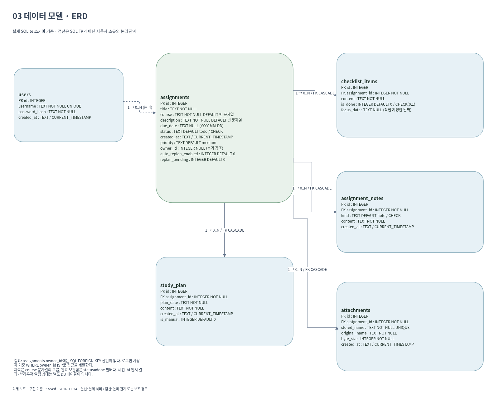

# 데이터 모델 및 ERD

구현 기준: `537e49f`, 2026-11-24. 아래 표는 앱 초기화가 끝난 **테스트용 빈 SQLite DB의 PRAGMA**로 확인한 현재 스키마다. 개인 데이터는 읽지 않았다.

## 1. 관계

- `users` → `assignments`: 사용자 한 명이 여러 과제를 가진다는 **논리 관계**다. `owner_id`는 SQL FK가 아니며 NULL을 허용한다. 실제 접근은 로그인 세션의 사용자 ID 조건으로 제한한다.
- `assignments` → `checklist_items`, `assignment_notes`, `study_plan`, `attachments`: 각 1:N 관계이며, 자식의 `assignment_id`는 NOT NULL FK다. `ON DELETE CASCADE`를 선언했다.
- 실제 첨부파일은 파일시스템에 있으므로 DB cascade만으로 삭제되지 않는다. 과제 삭제 경로가 첨부파일을 먼저 정리하고 과제 행을 삭제한다.
- 연결마다 `PRAGMA foreign_keys=ON`을 적용한다. 사용자 삭제 경로는 구현되어 있지 않다.

## 2. 테이블 사전

모든 `id`는 `INTEGER PRIMARY KEY AUTOINCREMENT`다. `created_at`은 `TEXT NOT NULL DEFAULT CURRENT_TIMESTAMP`로 생성하며 SQLite 기본 시각은 UTC다. 아래의 앱 길이 제한과 DB 제약을 구분한다.

### `assignment_notes`

| 필드 | SQLite 형식 | NULL | 기본값 / 키 | 의미·앱 검증 |
|---|---|---|---|---|
| `id` | `INTEGER` | 불가(PK) | `PK` | 메모 식별자 |
| `assignment_id` | `INTEGER` | 불가 | `—` | 소속 과제 FK |
| `kind` | `TEXT` | 불가 | `'note'` | note 메모 / progress 진행 기록 |
| `content` | `TEXT` | 불가 | `—` | 기록 내용; 앱 입력 1~2,000자 |
| `created_at` | `TEXT` | 불가 | `CURRENT_TIMESTAMP` | 작성 시각 |

추가 제약: `CHECK(kind IN ('note','progress'))`

### `assignments`

| 필드 | SQLite 형식 | NULL | 기본값 / 키 | 의미·앱 검증 |
|---|---|---|---|---|
| `id` | `INTEGER` | 불가(PK) | `PK` | 과제 식별자 |
| `title` | `TEXT` | 불가 | `—` | 과제명; 앱 저장 검증 1~120자 |
| `course` | `TEXT` | 불가 | `''` | 과목명; 앱 저장 검증 최대 100자 |
| `description` | `TEXT` | 불가 | `''` | 설명; 앱 저장 검증 최대 5,000자 |
| `due_date` | `TEXT` | 가능 | `—` | 제출일 ISO 문자열; 미지정 가능 |
| `status` | `TEXT` | 불가 | `'todo'` | todo / doing / done; done은 완료 보관함 |
| `created_at` | `TEXT` | 불가 | `CURRENT_TIMESTAMP` | 등록 시각 |
| `priority` | `TEXT` | 불가 | `'medium'` | low / medium / high; 앱에서 허용값 검증 |
| `owner_id` | `INTEGER` | 가능 | `—` | users.id 논리 참조; SQL FK 없음, 레거시 NULL 허용 |
| `auto_replan_enabled` | `INTEGER` | 불가 | `0` | 자동 재계획 사용 여부; 앱에서 0/1 사용 |
| `replan_pending` | `INTEGER` | 불가 | `0` | 자동 재계획 대기/실패 표시; 앱에서 0/1 사용 |

추가 제약: `CHECK(status IN ('todo','doing','done'))`; `idx_assignments_owner` 인덱스. priority/두 플래그에는 SQL CHECK가 없고 앱에서 검증/관리한다.

### `attachments`

| 필드 | SQLite 형식 | NULL | 기본값 / 키 | 의미·앱 검증 |
|---|---|---|---|---|
| `id` | `INTEGER` | 불가(PK) | `PK` | 첨부 메타데이터 식별자 |
| `assignment_id` | `INTEGER` | 불가 | `—` | 소속 과제 FK |
| `stored_name` | `TEXT` | 불가 | `—` | 실제 저장 파일명; UUID 기반 임의 이름 |
| `original_name` | `TEXT` | 불가 | `—` | 사용자가 선택한 파일명; 앱 최대 180자 |
| `byte_size` | `INTEGER` | 불가 | `—` | 파일 바이트 수; 앱 파일당 5MB 제한 |
| `created_at` | `TEXT` | 불가 | `CURRENT_TIMESTAMP` | 첨부 시각 |

추가 제약: `UNIQUE(stored_name)`

### `checklist_items`

| 필드 | SQLite 형식 | NULL | 기본값 / 키 | 의미·앱 검증 |
|---|---|---|---|---|
| `id` | `INTEGER` | 불가(PK) | `PK` | 체크 항목 식별자 |
| `assignment_id` | `INTEGER` | 불가 | `—` | 소속 과제 FK |
| `content` | `TEXT` | 불가 | `—` | 할 일; 앱 입력 1~300자 |
| `is_done` | `INTEGER` | 불가 | `0` | 0 미완료 / 1 완료 |
| `focus_date` | `TEXT` | 가능 | `—` | 오늘 직접 지정한 ISO 날짜; 오늘과 같을 때 표시 |

추가 제약: `CHECK(is_done IN (0,1))`

### `study_plan`

| 필드 | SQLite 형식 | NULL | 기본값 / 키 | 의미·앱 검증 |
|---|---|---|---|---|
| `id` | `INTEGER` | 불가(PK) | `PK` | 학습 계획 항목 식별자 |
| `assignment_id` | `INTEGER` | 불가 | `—` | 소속 과제 FK |
| `plan_date` | `TEXT` | 불가 | `—` | 작업 예정일; ISO 날짜 문자열 |
| `content` | `TEXT` | 불가 | `—` | 작업 내용; 앱 입력 1~300자 |
| `created_at` | `TEXT` | 불가 | `CURRENT_TIMESTAMP` | 생성 시각 |
| `is_manual` | `INTEGER` | 불가 | `0` | 직접 수정하면 1; 자동 재계획 시 보존 |

### `users`

| 필드 | SQLite 형식 | NULL | 기본값 / 키 | 의미·앱 검증 |
|---|---|---|---|---|
| `id` | `INTEGER` | 불가(PK) | `PK` | 계정 식별자 |
| `username` | `TEXT` | 불가 | `—` | 로그인 아이디; 소문자·숫자·밑줄 3~32자 |
| `password_hash` | `TEXT` | 불가 | `—` | Werkzeug 해시; 원문 비밀번호 저장 안 함 |
| `created_at` | `TEXT` | 불가 | `CURRENT_TIMESTAMP` | 계정 생성 시각 |

추가 제약: `UNIQUE(username)`

## 3. 파생 데이터와 테이블을 만들지 않은 항목

| 서비스 개념 | 실제 표현 |
|---|---|
| 과목별 보기 | `assignments.course`를 GROUP BY; 과목 테이블 없음 |
| 진행 목록 / 완료 보관함 | `status != 'done'` / `status = 'done'`; 보관함 테이블·복사본 없음 |
| 오늘 직접 할 일 | `checklist_items.focus_date = 서버의 오늘`; 완료 항목·완료 과제 제외 |
| 자동으로 표시되는 오늘 작업 | 오늘 마감 과제의 미완료 체크리스트 + 오늘 날짜의 학습 계획 |
| 체크리스트 진행률 | `is_done` 합계 / 항목 수; 항목 없으면 0% |
| 가까운 마감 | 제출일 있는 미완료 과제를 기한 순 조회해 대시보드 최대 4개 표시 |
| 같은 날 마감 충돌 | 미완료 과제를 due_date별 그룹, 2개 이상 묶음 |
| AI 분석 결과 | 검토 폼의 임시 값; 저장 시 assignment와 checklist로 변환 |
| 필수 제출물 | 별도 테이블 없음; AI 저장 시 과제 description의 텍스트로 구성 |
| 세션·알림 동의 | 서명 쿠키 / 브라우저 localStorage, DB 테이블 없음 |

`focus_date`에 과거 날짜가 남아 있어도 오늘 날짜가 아니면 직접 지정 작업으로 표시하지 않는다. 오늘 마감으로 자동 표시되는 항목은 직접 지정 해제 후에도 표시될 수 있다.

## 4. 상태 변화

| 대상 | 변화 | 효과 |
|---|---|---|
| 과제 | todo ↔ doing | 진행 목록 유지; 설정과 실제 변경 여부에 따라 자동 재계획 가능 |
| 과제 | todo/doing → done | 완료 보관함으로 이동; 직접 지정 날짜 해제, 재계획 pending 해제 |
| 과제 | done → todo/doing | 진행 목록으로 복귀; 기존 과제/자식 항목 유지 |
| 체크리스트 | is_done 0 ↔ 1 | 완료율과 오늘 표시 재계산; 체크리스트 변경의 재계획 정책 적용 |
| 오늘 지정 | focus_date NULL/이전 날짜 ↔ 오늘 | 수동 지정/해제; 마감일 자체는 변경하지 않음 |
| 학습 계획 | is_manual 0 → 1 | 사용자가 날짜/내용 수정; 자동 재계획의 교체 대상에서 제외 |
| 자동 재계획 | pending 0 → 1 → 0 | 시도 중/실패 표시에 사용, 성공 저장 후 해제; 별도 비동기 Job 상태가 아님 |

직접 일정 ‘생성/다시 생성’은 기존 모든 학습 계획을 교체한다. 자동 재계획만 `is_manual=1`을 보존한다.

## 5. 입력·응답·저장 한도

| 항목 | 실제 기준 |
|---|---|
| 아이디 / 비밀번호 | 가입 시 아이디 3~32자, 비밀번호 10~128자; 비밀번호 해시 저장 |
| 과제 | title 1~120자, course ≤100자, description ≤5,000자 |
| 체크리스트 / 메모 | 1~300자 / 1~2,000자 |
| 분석 입력 | 공지 ≤10,000자, 추가 요구사항 ≤2,000자; 공지 또는 파일 필요 |
| AI 검토 저장 | summary ≤2,000자; 제출물·할 일 각각 ≤30개, 항목당 ≤300자 |
| AI 결과 정규화 | 잘못된 날짜는 빈 값; 요약 초과는 오류; 목록 문자열은 항목당 300자로 정규화 |
| AI 저장 설명 | 요약과 제출물 문구를 합친 최종 description에도 5,000자 제한 적용 |
| 일반 첨부 | PDF/PNG/JPG/JPEG/TXT/DOCX, 파일당 ≤5MB; 확장자·내용 검사 |
| AI 첨부 | PDF/PNG/JPG/JPEG, ≤5MB; 텍스트와 한 요청으로 함께 분석 |
| 학습 계획 생성 | 오늘부터 최대 14일 범위, 검증 통과한 1~20개 항목 |
| 백업 | ZIP ≤50MB, 풀린 크기 합계 ≤100MB, data.json ≤2MB, 표별 ≤5,000행 |
| Flask 요청 | 64MB 전체 요청 상한; 개별 분석/첨부 파일의 5MB 제한은 별도로 유지 |

이 제한 중 상당수는 SQL 타입/길이 제한이 아니라 애플리케이션 검증이다. 앱은 ORM 없이 매개변수 SQL로 접근한다.

## 6. 마이그레이션·백업과 실제 파일

- `init_db`, `init_planning_db`, `register_productivity`가 테이블과 누락 열을 추가한다. 기존 행을 삭제하는 초기화가 아니다.
- `owner_id`의 NULL은 기존 미귀속 과제를 위해 남아 있다. 첫 계정 생성 시 기존 정책으로 귀속한다.
- 파일 저장명은 원래 파일명과 분리한다. 다운로드/삭제 전 부모 과제의 소유권을 확인한다.
- 백업은 계정별 5개 업무 테이블의 기록과 파일을 담는다. `users` 및 서버 설정은 포함하지 않는다.
- 복원은 현재 계정 owner_id와 새 PK로 추가하고 자식 FK를 새 ID로 재매핑한다. 직접 지정 날짜, 기록 작성일, 수동 일정 구분을 보존한다. `replan_pending`은 새 항목에서 초기화한다.
- 기존 SQLite 전체를 교체하는 복원이 아니므로 기존 사용자/과제를 덮어쓰지 않는다. 동일 ZIP을 반복 복원하면 중복 항목이 추가된다.

실제 필드·DDL·FK·인덱스: [implementation-inventory.json](diagrams/implementation-inventory.json). ERD 원본은 [draw.io 파일](diagrams/assignment-system.drawio)의 03 페이지다.
