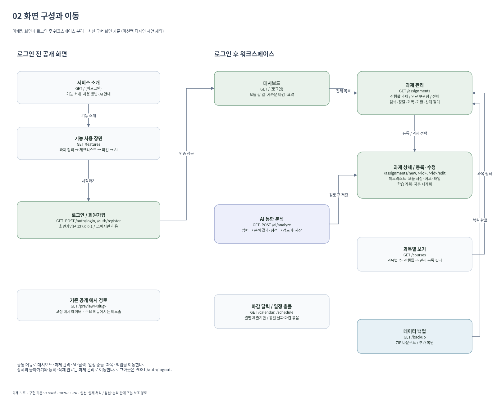

# 화면 구성 및 이동 설계

기준: 구현 커밋 `537e49f`, 2026-11-24. 미선택 UI 시안을 채택하지 않고 현재 동작하는 화면을 정리한다.

## 1. 정보 구조

### 로그인 전

상단에는 과제 노트 로고, 주요 기능·사용 방법·AI 분석 앵커, 로그인/시작 버튼이 있다. 공개 소개는 개인 DB를 조회하지 않는다. `/features`는 21개 내부 기능 번호의 카드 목록이 아니라 네 개 사용 장면을 설명한다. 기존 `/preview/<slug>`는 호환용 고정 예시 경로로 남아 있지만 주요 메뉴에서는 노출하지 않는다.

### 로그인 후

공통 사이드바는 대시보드, 과제 관리, AI 공지 분석, 마감 달력, 일정 충돌, 과목별 보기, 데이터 백업을 제공한다. 과제 상세·등록·수정은 과제 관리 메뉴에 속한다. 작은 화면에서는 메뉴 버튼으로 탐색을 열며 Escape로 닫을 수 있다.

## 2. 화면별 구성

| 화면 / 템플릿 | 경로 / 접근 | 핵심 내용 | 주요 행동·다음 화면 |
|---|---|---|---|
| 서비스 소개 `public_home.html` | `/`, 비로그인 | 서비스 가치, 실제 예시 이미지, 사용 순서, AI 범위, FAQ | 로그인, 기능 사용 장면, 홈페이지 앵커 |
| 기능 사용 장면 `public_features.html` | `/features`, 공개 | 과제 모으기·작게 나누기·마감 확인·AI 도움 | 장면별 앵커, 로그인 |
| 고정 예시 `public_preview.html` | `/preview/<slug>`, 공개 | 실제 개인 자료가 아닌 고정 예시 | 로그인, 소개 |
| 로그인 `auth.html` | `/auth/login`, 공개 | 아이디/비밀번호, 오류 상태 | 성공 시 `/` |
| 회원가입 `auth.html` | `/auth/register`, 로컬만 | 계정 규칙, 중복 오류 | 성공 시 로그인된 `/`; 원격은 403 |
| 대시보드 `dashboard.html` | `/`, 로그인 | 전체/진행 중/기한 지난 수, 오늘 작업, 가까운 마감 최대 4개, 체크리스트 진행률 | 오늘 작업 완료, 과제 상세/관리, 달력 |
| 상세 통계 `dashboard_analytics.html` | 대시보드 내 포함 | 상태별·과목별 분포 | 기본은 펼침 메뉴 안에 배치 |
| 과제 관리 `assignments.html` | `/assignments`, 로그인 | 진행할 과제·완료 보관함·전체 탭, 검색·상태·우선순위·기한·과목·정렬 | 상세 선택, 새 과제, 빠른 상태 변경 |
| 과제 등록/수정 `assignment_form.html` | `/assignments/new`, `/<id>/edit`, 로그인 | 제목·과목·제출일·상태·우선순위·설명 | 등록 후 관리, 수정 후 상세, 오류면 입력 유지 |
| 과제 상세 `assignment_detail.html` | `/assignments/<id>`, 소유자만 | 기본 정보, 체크리스트, 오늘 지정, 학습 일정, 첨부파일, 메모/진행 기록 | 수정·삭제·체크 완료·지정·일정 생성/수정·파일 작업 |
| AI 통합 분석 `ai_analyze.html` | `/ai/analyze`, 로그인 | 공지 원문, PDF/이미지, 추가 요구사항, 분석 상태, 결과 점검, 검토/저장 폼 | 분석·수정·수량 재점검·과제로 저장 |
| 마감 달력 `calendar.html` | `/calendar?month=YYYY-MM`, 로그인 | 제출기한 있는 과제만 월별 표시, 상태 텍스트, 다건 보기 | 월 이동, 과제 상세, 날짜별 더보기 대화상자 |
| 일정 충돌 `schedule.html` | `/schedule`, 로그인 | 같은 날 마감되는 미완료 과제와 규칙 기반 시작일 제안 | 해당 과제 상세 |
| 과목별 보기 `courses.html` | `/courses`, 로그인 | 과목별 전체·진행할 수·완료 수·완료 비율, 미지정 그룹 | 과목 필터가 적용된 관리 목록 |
| 데이터 백업 `backup.html` | `/backup`, 로그인 | 계정별 ZIP 다운로드, 추가 복원 파일·동의 | 다운로드, 복원 후 전체 관리 목록 |

`/<id>/edit` 같은 생략 표기는 `/assignments/<id>/edit`를 뜻한다. 사용자 프로필·학점·수업 시간표·LMS 연동·타이머 화면은 구현되어 있지 않다.

## 3. 대시보드와 과제 관리의 역할 구분

| 구분 | 대시보드 | 과제 관리 |
|---|---|---|
| 목적 | 오늘의 우선 행동 파악 | 전체 기록 탐색·수정·완료 상태 관리 |
| 목록 범위 | 오늘 작업 + 기한 있는 미완료 과제 최대 4개 | 선택된 탭/필터의 전체 과제 |
| 기본 보기 | 오늘 요약 | 미완료(`active`) |
| 세부 정보 | 통계·알림은 접어서 제공 | 체크리스트 진행률·우선순위·상태·기한을 정렬 |
| 완료 | 오늘 작업 체크 | 상태를 `done`으로 바꿔 보관함 이동 |
| 복귀 | 과제 관리 버튼 | 보관함에서 `todo/doing`으로 바꿔 진행 목록 복귀 |

`/?q=...` 등 이전 대시보드 검색 링크는 조건을 유지한 `/assignments`로 안내한다. 보관함은 삭제가 아니며 DB 복제도 없다.

## 4. 중요한 상태와 피드백

- **빈 상태:** 과제 없음, 오늘 작업 없음, 검색 결과 없음, 완료 과제 없음, 과목 없음은 각각 안내와 다음 행동을 보여준다.
- **저장 상태:** 변경 후 flash 안내와 리다이렉트를 사용한다. AI 분석은 분석 버튼의 중복 클릭을 막고 진행 상태를 표시한다.
- **오류:** 폼 필드 오류, 인증/권한/CSRF, 파일 형식·크기, API 실패를 구분한다. 분석 오류 후 요구사항을 유지하지만 브라우저 파일 선택은 다시 해야 한다.
- **AI 점검:** 수량 조건 충족/불일치와 의미적 직접 검토를 구분한다. 편집 후 재점검은 내용을 재생성하지 않는다.
- **오늘 직접 지정:** `focus_date`가 오늘인 미완료 작업을 표시한다. 오늘 마감인 미완료 작업·오늘 계획은 자동 표시된다. 기한 없는 작업은 직접 지정한다. 네 개 이후 직접 작업은 펼쳐서 확인한다.
- **백업:** 복원은 현재 데이터에 새 항목을 추가하며 반복 복원 시 중복이 생길 수 있음을 확인받는다. 기존 기록을 덮어쓰지 않는다.

## 5. 공통 UI와 접근성

- 기본 스타일은 `campus.css`, 공개 소개 전용 구성은 `marketing.css`를 사용한다. 기존 `style.css`도 함께 로드된다.
- 화면 제목/설명, 명시적인 폼 label, 상태 텍스트, focus 스타일, 알림의 `role=status`를 제공한다.
- 상태는 색상만으로 구분하지 않는다. 모바일 과제 행은 여러 줄로 재배치하고 넓은 달력은 내부 스크롤을 사용한다.
- 분석 검토, 빠른 상태 변경, 오늘 완료 같은 변경은 실제 POST 경로로 처리한다. 단순 시연 이미지는 예시라고 표기한다.
- 자동 접근성 검사와 브라우저 검증의 기록은 [검증 안내](design/VALIDATION.md)에 있다. 전체 WCAG 준수나 모든 보조공학 환경의 검증을 의미하지 않는다.

## 6. 제출/발표에 사용할 현재 화면

[대시보드 PC](design/dashboard-desktop.png) · [대시보드 모바일](design/dashboard-mobile.png) · [과제 관리 PC](design/assignments-desktop.png) · [과제 관리 모바일](design/assignments-mobile.png) · [과목별 보기](design/courses-desktop.png) · [백업 모바일](design/backup-mobile.png)

이미지는 구현 검증 때 임시 계정/예시 과제로 촬영한 기록이다. 생성형 디자인 시안과 구분한다.
